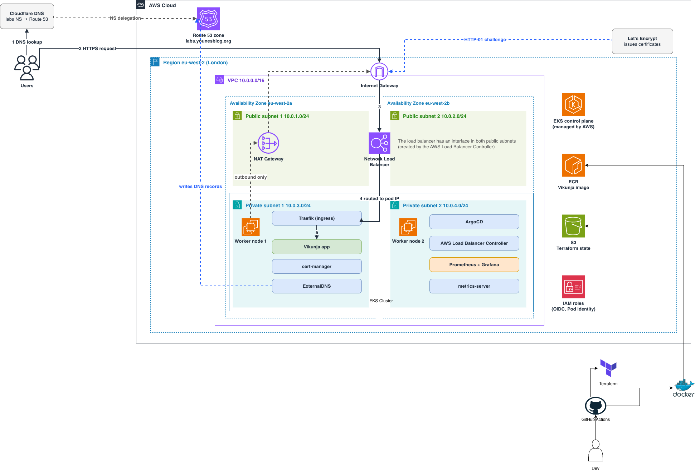
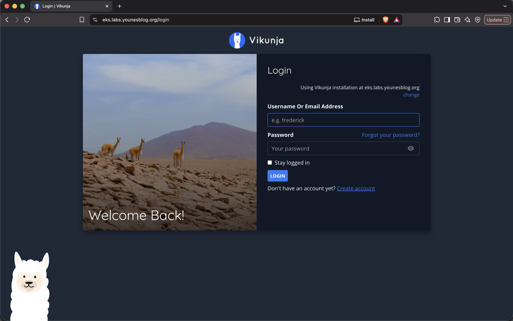
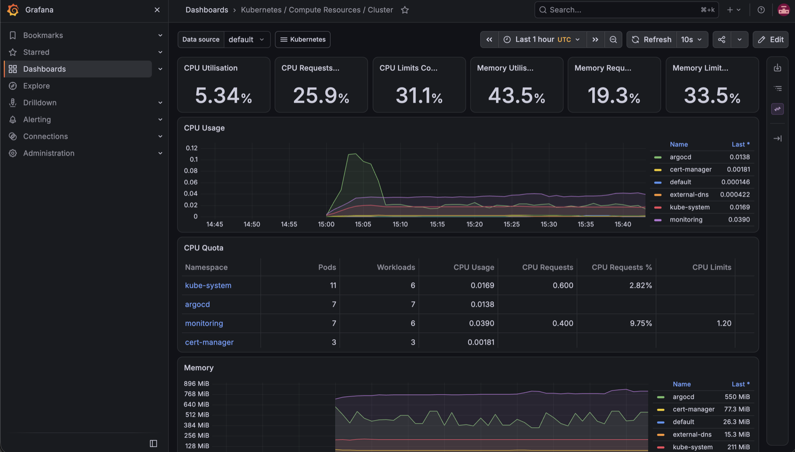
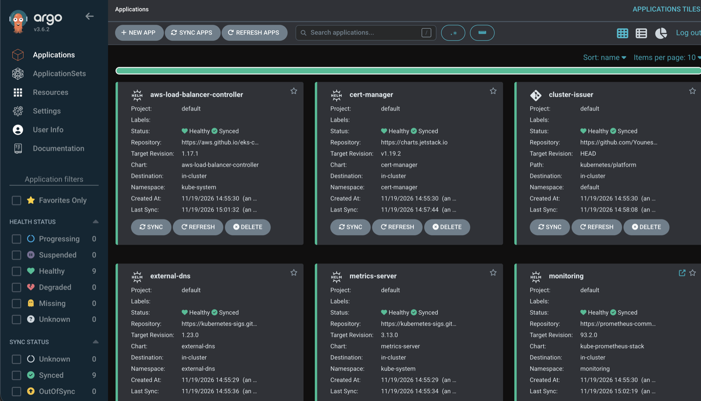

# vikunja-eks

A production-style deployment of [Vikunja](https://vikunja.io) (an open-source to-do app) on **Amazon EKS**. The whole stack is automated: infrastructure with Terraform, deployments with ArgoCD, security scanning in CI, automatic DNS and HTTPS certificates, and monitoring with Prometheus and Grafana.

Live at **https://eks.labs.younesblog.org** when the cluster is running.

## Architecture




## Screenshots

**Vikunja**, running on the cluster at `https://eks.labs.younesblog.org` with a Let's Encrypt certificate:



**Grafana**, showing cluster resource usage from Prometheus:



**ArgoCD**, with every application Synced and Healthy:



## What this project demonstrates

| Area | What was built |
|---|---|
| **Infrastructure as code** | Terraform modules for the VPC and EKS. Remote state in S3 with locking and encryption. |
| **Network design** | Public subnets for the load balancer, private subnets for the worker nodes, NAT gateway for outbound traffic, two availability zones. |
| **Least-privilege IAM** | Separate roles for the cluster, the nodes and each controller (EKS Pod Identity). GitHub Actions signs in with OIDC, so no AWS keys are stored anywhere. |
| **GitOps** | ArgoCD watches this repo and keeps the cluster matching it. A single `root-app` manages every other app. |
| **Ingress and TLS** | Traefik behind an AWS Network Load Balancer. cert-manager gets free Let's Encrypt certificates automatically. |
| **Dynamic DNS** | ExternalDNS creates Route 53 records from Kubernetes Ingress resources. |
| **CI/CD and security** | Pipelines for Terraform, Docker builds, Trivy image scans and Checkov Terraform scans. |
| **Observability** | Prometheus and Grafana with dashboards for cluster, node, pod and ingress traffic. |

## Tech stack

AWS (EKS, VPC, Route 53, ECR, S3, IAM) · Terraform · Kubernetes · ArgoCD · Helm · Traefik · cert-manager · ExternalDNS · AWS Load Balancer Controller · Prometheus · Grafana · GitHub Actions · Docker · Trivy · Checkov

## How it works

1. **Terraform** creates the network, the EKS cluster, the DNS zone and the IAM roles.
2. **ArgoCD** is pointed at this repo. It installs everything in `kubernetes/argo-cd/`: Traefik, cert-manager, ExternalDNS, the load balancer controller, monitoring and the app itself.
3. A request for `eks.labs.younesblog.org` resolves through **Route 53** (record written by ExternalDNS) to a **Network Load Balancer** (created by the load balancer controller), then reaches **Traefik**, which routes it to the app.
4. **cert-manager** issues the HTTPS certificate that Traefik serves.
5. When app code changes, **GitHub Actions** builds an image, scans it, pushes it to **ECR**, and commits the new image tag to this repo. ArgoCD sees the commit and rolls out the new version.

## CI/CD pipelines

| Workflow | Runs when | What it does |
|---|---|---|
| [`terraform.yml`](.github/workflows/terraform.yml) | Changes in `terraform/` | Scans the Terraform with Checkov and TFLint first. If those pass: format check, validate, plan, apply. State is stored remotely in S3. |
| [`docker.yml`](.github/workflows/docker.yml) | Changes in `vikunja/` | Builds the image, scans it with Trivy (fails on HIGH or CRITICAL), pushes it to ECR, then updates the image tag in the Kubernetes manifest. |
| [`destroy.yml`](.github/workflows/destroy.yml) | Manual (type `destroy` to confirm) | Removes the load balancer and its leftovers created inside the cluster, then runs `terraform destroy`. |

## Repository layout

```
.
├── terraform/
│   ├── bootstrap/        # One-time setup: state bucket, ECR, GitHub OIDC roles
│   ├── modules/vpc/      # VPC, subnets, NAT, route tables
│   ├── modules/eks/      # EKS cluster, node group, add-ons, IAM, security group rule
│   └── route53.tf        # DNS zone for labs.younesblog.org
├── kubernetes/
│   ├── root-app.yml      # ArgoCD app-of-apps entry point
│   ├── argo-cd/          # One ArgoCD Application per component
│   ├── app/              # Vikunja Deployment, Service and Ingress
│   └── platform/         # Let's Encrypt ClusterIssuer
├── vikunja/              # Application source and Dockerfile
├── docs/images/          # Architecture diagram and screenshots
└── .github/workflows/    # CI/CD pipelines
```

## Setup

### Prerequisites

- An AWS account and the AWS CLI, signed in with admin rights
- Terraform 1.10 or newer, `kubectl`, and `git`
- A domain you control. This project uses a `labs.` subdomain, delegated from Cloudflare to Route 53.
- A fork of this repository

### 0. Change the values that belong to you

These are specific to the original author and must be replaced in a fork:

| Value | Where |
|---|---|
| AWS account ID | `terraform/backend.tf`, `terraform/bootstrap/main.tf`, `terraform/bootstrap/oidc.tf`, `kubernetes/app/vikunja-deployment.yaml` |
| Domain `labs.younesblog.org` | `terraform/route53.tf`, `kubernetes/argo-cd/external-dns.yml`, `kubernetes/argo-cd/monitoring.yml`, `kubernetes/app/` |
| Let's Encrypt email | `kubernetes/platform/letsencrypt-cluster-issuer.yaml` |
| GitHub repo URL | `kubernetes/root-app.yml` and every Application in `kubernetes/argo-cd/` |
| Your IAM user or role ARN (for `kubectl` access) | `eks_viewer_principal_arn` in `terraform/terraform.tfvars` |

### 1. Bootstrap (one time, run locally)

This creates the S3 state bucket, the ECR repository and the GitHub OIDC roles. It uses local state.

```bash
cd terraform/bootstrap
cat > terraform.tfvars <<EOF
project_name        = "vikunja"
github_oidc_subject = "repo:<your-github-user>/<your-repo>:ref:refs/heads/main"
EOF

terraform init
terraform apply
```

Note the outputs `github_ecr_role_arn` and `github_terraform_role_arn`.

### 2. Add GitHub secrets

In the repository, go to Settings → Secrets and variables → Actions and add:

| Secret | Value |
|---|---|
| `AWS_ROLE_ARN` | `github_ecr_role_arn` from the bootstrap output |
| `tf_AWS_ROLE_ARN` | `github_terraform_role_arn` from the bootstrap output |

### 3. Create the infrastructure

Push a change to `main` under `terraform/`, or run the **Terraform Deploy** workflow manually. This creates the VPC, the EKS cluster and the Route 53 zone. It takes about 15 minutes.

### 4. Delegate DNS

Terraform prints the Route 53 name servers (`labs_name_servers`). In your DNS provider (Cloudflare here), add `NS` records for `labs` pointing to those four name servers. Certificates cannot be issued until this works.

### 5. Connect to the cluster

```bash
aws eks update-kubeconfig --name eks-cluster --region eu-west-2
kubectl get nodes
```

This only works if your IAM identity is set as `eks_viewer_principal_arn` (step 0).

### 6. Install ArgoCD and start GitOps

```bash
kubectl create namespace argocd
kubectl apply -n argocd --server-side -f https://raw.githubusercontent.com/argoproj/argo-cd/stable/manifests/install.yaml
kubectl apply -f kubernetes/root-app.yml
```

ArgoCD now installs everything in `kubernetes/argo-cd/` by itself.

### 7. Two values that must be filled in by hand

**The VPC ID.** Copy it from the Terraform output and commit it. The load balancer controller will not start without it.

```bash
cd terraform && terraform output vpc_id
```

Replace `REPLACE_WITH_VPC_ID` in `kubernetes/argo-cd/aws-load-balancer-controller.yml`, commit and push.

**The Grafana admin password.** It is kept out of Git on purpose.

```bash
kubectl -n monitoring create secret generic grafana-admin \
  --from-literal=admin-user=admin \
  --from-literal=admin-password='<choose-a-strong-password>'
```

### 8. Build and deploy the app

Run the **Docker Push** workflow (or push a change under `vikunja/`). It builds and scans the image, pushes it to ECR, and replaces the `placeholder` tag in `kubernetes/app/vikunja-deployment.yaml` with the real one. ArgoCD then deploys it.

### 9. Check that it works

```bash
kubectl get applications -n argocd          # all should be Synced and Healthy
kubectl get certificate                     # vikunja-tls should be Ready
```

Then open `https://eks.labs.<your-domain>`.

### 10. Open ArgoCD and Grafana

**Grafana** has a public address with HTTPS: `https://grafana.labs.<your-domain>`.

- Username: `admin`
- Password: the one you chose in step 7. To read it back:
  ```bash
  kubectl -n monitoring get secret grafana-admin -o jsonpath='{.data.admin-password}' | base64 -d
  ```

**ArgoCD** is not exposed to the internet on purpose. It can change everything in the cluster, so a public login page is a high-value target. Grafana has a public address because it has an Ingress in `kubernetes/argo-cd/monitoring.yml`. ArgoCD has none. Reach it through a local tunnel:

```bash
kubectl port-forward svc/argocd-server -n argocd 8080:443
```

Leave that running and open `https://localhost:8080` (accept the browser's certificate warning, the certificate is self-signed).

- Username: `admin`
- Password: generated during install. Read it with:
  ```bash
  kubectl -n argocd get secret argocd-initial-admin-secret -o jsonpath='{.data.password}' | base64 -d
  ```

In ArgoCD you can see every application as a tree of Kubernetes objects, their sync status and health, and the Git commit each one is running.

If the Grafana address does not work yet (for example the certificate is still being issued), you can reach it the same way:

```bash
kubectl port-forward svc/monitoring-grafana -n monitoring 3000:80
```

Then open `http://localhost:3000`.

## Monitoring

Grafana ships with the standard Kubernetes dashboards for cluster, node, namespace and pod resource usage, plus the official Traefik dashboard for ingress traffic. Prometheus collects metrics from nodes, pods, kube-state-metrics and Traefik.

## Teardown

The cluster costs money while it runs (NAT gateway, load balancer, nodes). To remove it:

1. In GitHub, go to Actions → **Destroy** → Run workflow, and type `destroy` to confirm.
2. The workflow does the cleanup that Terraform cannot do on its own. The load balancer and its security groups were created by a controller inside the cluster, not by Terraform, and they block the VPC from being deleted. In order, it:
   - deletes the ArgoCD applications so nothing is recreated
   - deletes the `traefik` namespace, which makes the load balancer controller remove the load balancer
   - waits until AWS has released the load balancer's network interfaces
   - removes any leftover `k8s-*` security groups
   - runs `terraform destroy`
3. Delete the DNS records that ExternalDNS created in the Route 53 zone (`eks`, `grafana` and the TXT records), either before or after the run. Route 53 will not delete a zone that still has records, so without this the run fails at the very last step (the zone). Everything else is already gone by then.
4. If the zone is destroyed, the next build gets new name servers. Update the `labs` NS records in your DNS provider.
5. Optionally, run `terraform destroy` in `terraform/bootstrap` to remove the state bucket and ECR repository.

Afterwards, check in the AWS console that no EKS cluster, NAT gateway, load balancer or Elastic IP remains.

## Known limitations

- ArgoCD is installed with a manual `kubectl apply`, not by Terraform. It has no public address by design. Exposing it would need an Ingress with HTTPS, a strong admin password and ideally SSO.
- The VPC ID and the Grafana admin Secret are manual steps.
- Grafana and Prometheus data are not persistent, so UI-only changes and metrics history are lost on restart.
- The Terraform pipeline applies on push without a manual approval step.
- There is no plan on pull requests. A safe version needs a separate read-only AWS role for PR runs.
- Checkov and TFLint run in report-only mode while their findings are being reviewed.
