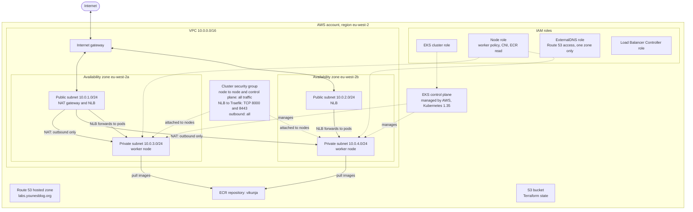
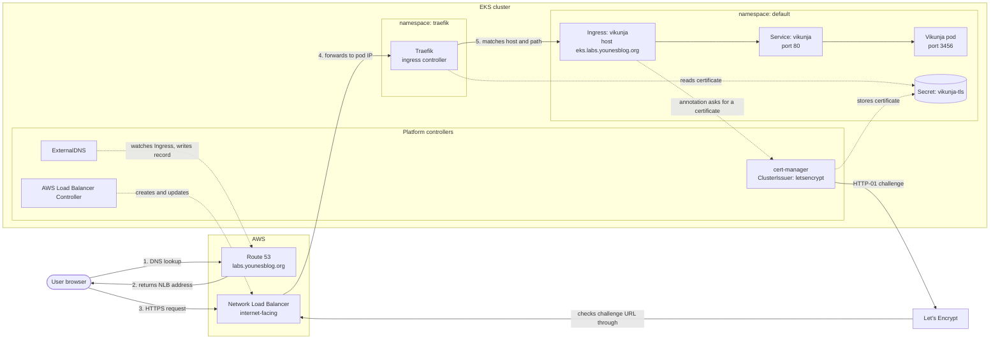
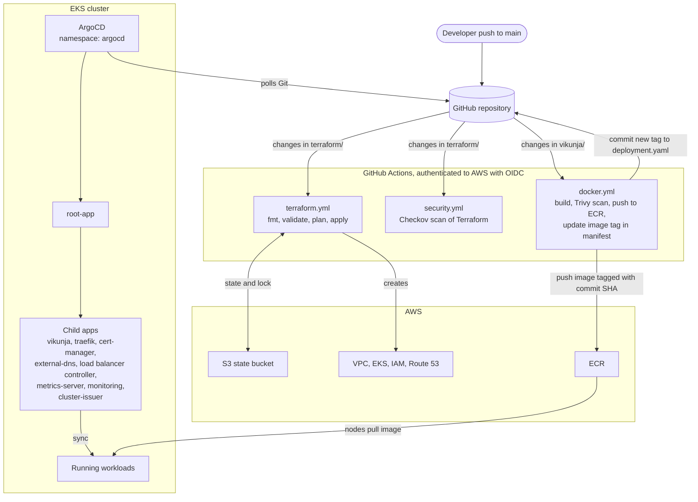
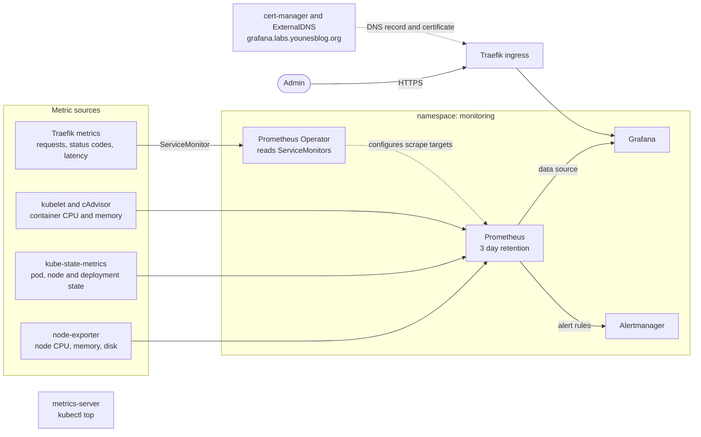

# Architecture

Vikunja running on Amazon EKS, provisioned with Terraform, deployed with ArgoCD,
secured with cert-manager and reachable at `https://eks.labs.younesblog.org`.

The architecture is split into four diagrams. Read them in order.

1. [AWS infrastructure](#1-aws-infrastructure): what exists in AWS
2. [Request flow, DNS and TLS](#2-request-flow-dns-and-tls): how a user reaches the app
3. [CI/CD and GitOps](#3-cicd-and-gitops): how code becomes a running app
4. [Monitoring](#4-monitoring): how the cluster is observed

---

## 1. AWS infrastructure

Everything lives in one VPC in `eu-west-2`, spread over two availability zones.
Worker nodes sit in **private** subnets and have no public IPs. The load balancer
sits in the **public** subnets. The nodes reach the internet (ECR, Let's Encrypt)
outbound only, through the NAT gateway.

| Part | What it does |
|---|---|
| Public subnets | Have a route to the internet gateway. Hold the NAT gateway and the load balancer. |
| Private subnets | Route outbound traffic to the NAT gateway. Hold the worker nodes, so nothing on the internet can connect to them directly. |
| Cluster security group | Created by EKS. Terraform adds one rule so the load balancer can reach Traefik. |
| IAM roles | The cluster and node roles are used by EKS and EC2. ExternalDNS and the load balancer controller each get their own role through EKS Pod Identity, so only those pods get those permissions. |
| S3 bucket | Remote Terraform state with versioning, encryption and lockfile locking. |

---

## 2. Request flow, DNS and TLS

This shows what happens when someone opens `https://eks.labs.younesblog.org`,
and how the DNS record and certificate got there in the first place.

**Walking through it**

1. **Load balancer:** Traefik's Service asks for a load balancer. The AWS Load Balancer Controller creates the NLB and registers Traefik's pod IPs as targets.
2. **DNS:** ExternalDNS sees the Ingress host and writes a record into Route 53 pointing at the NLB.
3. **Certificate:** the Ingress carries a cert-manager annotation. cert-manager asks Let's Encrypt for a certificate and proves domain ownership with an HTTP-01 challenge, which Let's Encrypt checks through the same NLB and Traefik. The certificate is stored in the `vikunja-tls` Secret.
4. **A request:** the browser looks up the name in Route 53, connects to the NLB over HTTPS, and Traefik presents the certificate. Traefik then routes the request to the Vikunja Service and pod.

---

## 3. CI/CD and GitOps

Terraform builds the cloud infrastructure. ArgoCD keeps the cluster matching what
is in Git. GitHub Actions never touches the cluster directly. It only builds
images and commits changes to Git.

**The loop that matters**

1. You push a change under `vikunja/`.
2. `docker.yml` builds the image, scans it with Trivy (the job fails on HIGH or CRITICAL findings), pushes it to ECR tagged with the commit SHA, then commits that SHA into `kubernetes/app/vikunja-deployment.yaml`.
3. ArgoCD sees the new commit and updates the Deployment, and Kubernetes pulls the new image from ECR.

The `root-app` is an app-of-apps. It points at `kubernetes/argo-cd/`, and every
file there is a child Application. With `selfHeal` and `prune` on, anything changed
by hand in the cluster is put back to what Git says.

**Not automated yet**

- ArgoCD itself is installed by hand and is not in this repo.
- The `grafana-admin` Secret is created by hand with `kubectl`.
- The VPC ID in `aws-load-balancer-controller.yml` is pasted in from `terraform output vpc_id` after each build.

---

## 4. Monitoring

kube-prometheus-stack runs in the `monitoring` namespace. Prometheus collects
metrics from the nodes, the pods and Traefik, and Grafana draws them.

| Component | Role |
|---|---|
| Prometheus | Scrapes and stores metrics. Configured to pick up ServiceMonitors from every namespace. |
| Grafana | Shows dashboards. Ships with the standard Kubernetes cluster, node, namespace and pod dashboards, plus the official Traefik dashboard for ingress traffic. Reached through Traefik with a Let's Encrypt certificate. |
| Alertmanager | Receives alerts from Prometheus rules. No receivers are configured yet. |
| metrics-server | Provides `kubectl top` and resource metrics to the Kubernetes API. It is separate from Prometheus. |
